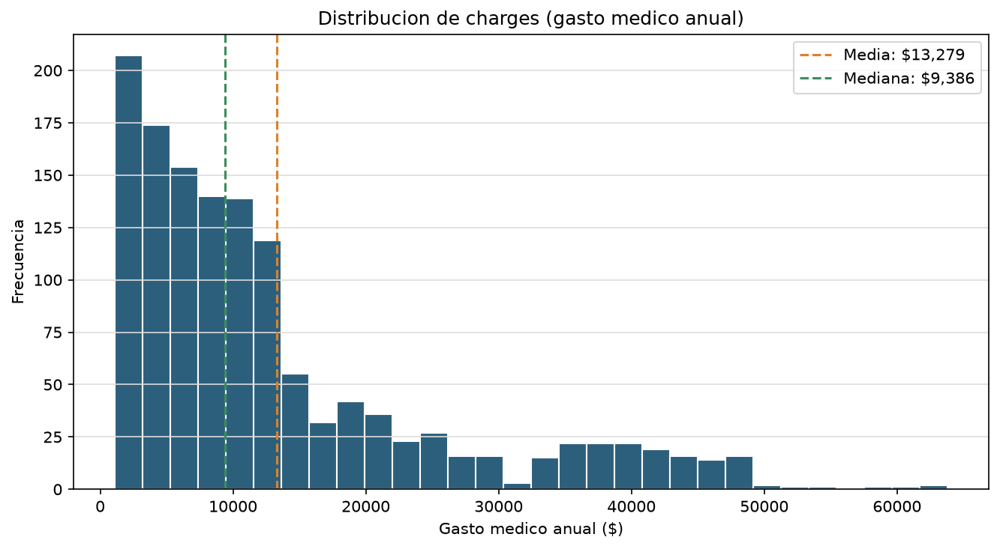
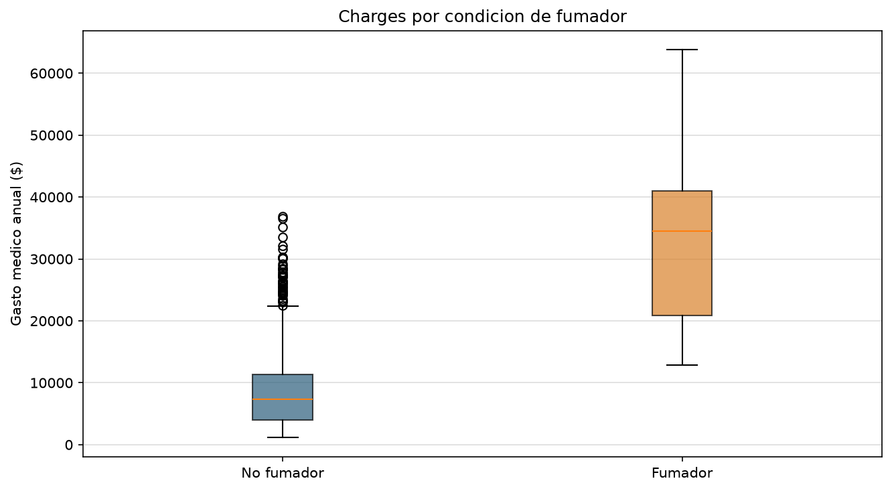
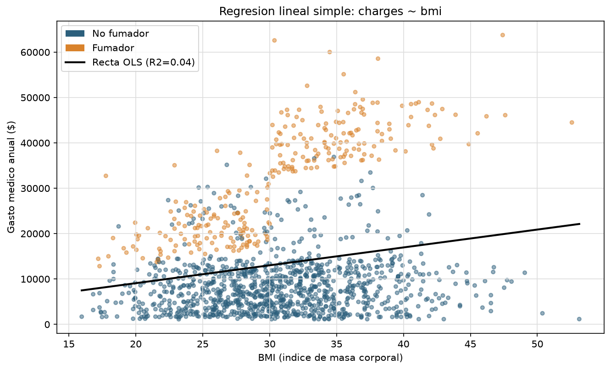
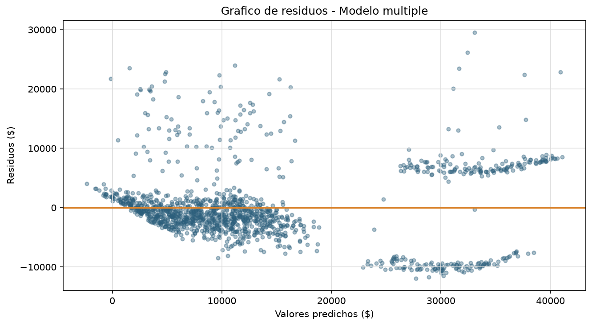

# 📊 Insurance Charges Analysis

Análisis estadístico del gasto médico anual facturado a asegurados en EE.UU. mediante estadística descriptiva, detección de outliers y regresión lineal simple y múltiple.
El proyecto explora qué variables del asegurado predicen mejor su gasto médico y cómo debería una aseguradora ajustar sus primas según el perfil de riesgo.

---

## 🚀 Objetivo

El objetivo del proyecto es analizar el gasto médico de asegurados para responder preguntas clave de pricing y gestión de riesgo:

- ¿Cómo se distribuye el gasto médico anual y qué tan simétrico es?
- ¿Existen valores atípicos, y son errores o información legítima?
- ¿Qué variable predice mejor el gasto médico por sí sola?
- ¿Qué combinación de variables explica mejor el gasto médico total?
- ¿Cómo debería una aseguradora ajustar sus primas según el perfil del asegurado?

---

## 📂 Dataset

Dataset utilizado:
Medical Cost Personal Datasets (Insurance Charges) — disponible en Kaggle.

https://www.kaggle.com/datasets/muqaddasejaz/healthcare-insurance-datasets

Incluye 1.338 registros de asegurados en EE.UU. con variables demográficas, clínicas y el gasto médico anual facturado.

---
## 🚀 Instalación

Clona el repositorio, crea el entorno, instala dependencias y ejecuta el proyecto:

```bash
git clone <url-del-repositorio>
cd Insurance_Charges_Analysis
python -m venv .venv

.venv\Scripts\activate   # Windows
source .venv/bin/activate   # Mac/Linux

pip install -r requirements.txt
python main.py
```

---

## ⚙️ Pipeline

1. Carga de datos
2. Limpieza y preparación
3. Feature engineering (variables dummy: smoker_yes, sex_male)
4. Estadística descriptiva y análisis de distribución
5. Detección de outliers (IQR y Z-score)
6. Regresión lineal simple y múltiple
7. Exportación de resultados

---

## 📈 Análisis

### 1. ¿Cómo se distribuye el gasto médico anual?

📌 Distribución de charges con media y mediana marcadas.



**Insight:**
La media de charges es **$13.270**, pero la mediana es **$9.382**: una diferencia del 42% que revela una distribución muy sesgada a la derecha (skewness = 1.51). La mayoría de asegurados gasta relativamente poco, pero una minoría con gastos muy altos empuja la media hacia arriba. El coeficiente de variación (91.3%) confirma una población de asegurados muy heterogénea.

---

### 2. ¿Los valores extremos son errores o información legítima?

📌 Boxplot de charges segmentado por condición de fumador.



**Insight:**
El método IQR detecta 139 outliers (10.4%), frente a solo 7 con Z-score, esperable dado que la distribución no es normal. Del total de outliers IQR, el **97.8% son fumadores**: no son errores de datos, sino un segmento de riesgo real que la aseguradora debe modelar explícitamente en vez de descartar.

---

### 3. ¿Qué tan bien predice el gasto médico una sola variable?

📌 Regresión lineal simple: charges ~ bmi.



**Insight:**
El modelo simple (charges ~ bmi) obtiene un R² de apenas **0.039**: el BMI por sí solo explica menos del 4% de la variación del gasto. El gráfico muestra por qué: existen dos nubes de puntos claramente separadas (fumadores y no fumadores) que una única recta no puede capturar, evidenciando el riesgo de omitir variables relevantes.

---

### 4. ¿Qué combinación de variables explica mejor el gasto médico?

📌 Residuos del modelo de regresión múltiple (age + bmi + children + smoker).



**Insight:**
El modelo múltiple alcanza un R² de **0.75**. El coeficiente de smoker_yes (+$23.811) domina ampliamente sobre age, bmi y children, confirmando que ser fumador es el factor de riesgo más determinante. El gráfico de residuos muestra un patrón en abanico (heterocedasticidad), señal de que un modelo no lineal o una transformación logarítmica podrían mejorar el ajuste en trabajos futuros. La correlación entre predictores numéricos es baja (<0.11), por lo que no hay problema de multicolinealidad.

---

## 🧠 Insight global

El gasto médico de un asegurado no puede explicarse por una sola característica: depende de la combinación de edad, condición física y, sobre todo, de hábitos de riesgo como fumar. Un modelo de pricing que ignore esta interacción subestimará sistemáticamente el riesgo real de una parte importante de la cartera de asegurados.

---

## 📁 Estructura del proyecto

```bash
Insurance_Charges_Analysis/
├── data/
│   ├── raw/                 # Dataset original (insurance.csv)
│   └── processed/           # Estadísticas, outliers y resultados de regresión
│
├── notebooks/              # Análisis exploratorio (EDA)
│
├── output/                 # Gráficos y visualizaciones generadas
│
├── src/
│   ├── cleaning/           # Limpieza de datos
│   ├── features/           # Variables dummy y detección de outliers
│   ├── io/                 # Carga y exportación de datos
│   ├── model/              # Regresión lineal simple y múltiple
│   ├── utils/              # Funciones auxiliares
│   └── viz/                # Visualizaciones
│
├── main.py                 # Pipeline principal del proyecto
├── requirements.txt        # Dependencias del proyecto
└── README.md               # Documentación del proyecto
```


---

## 👤 Autor

Adrián Potenciano Vila

Proyecto de Estadística — Insurance Charges Analysis
